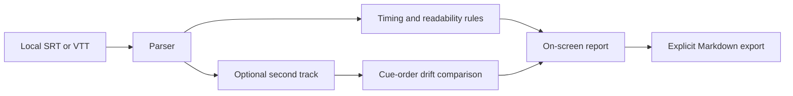

# CaptionLint — Subtitle Release QA


CaptionLint checks SRT and WebVTT subtitle files before release. It catches timing and readability problems and compares a translated track with its source. The browser app processes file contents locally and exports a Markdown report.

**Live app:** https://ghostnever-lkm.github.io/subtitle-release-gate/ · **Source:** https://github.com/GhosTnever-lkm/subtitle-release-gate

## What it checks

- Malformed SRT/WebVTT timestamps and missing WebVTT headers.
- Cue ends at or before their starts, and overlapping cues (including nested long cues and out-of-order blocks).
- Character-per-second reading speed, configurable from 1 to 60 (default 20).
- Maximum line length, configurable from 10 to 100 characters (default 42), and more than two lines per cue.
- Cues shorter than 700 ms or longer than 7 seconds, repeated adjacent text, and Unicode replacement characters that can signal damaged encoding.
- Between two tracks: different cue counts, blank cues and start/end timing drift greater than 500 ms.

The default values are practical review thresholds, not a substitute for a broadcaster, platform, language or accessibility style guide. A flagged value is a prompt for human review, not proof that a subtitle is wrong. The current comparison pairs cues by order; it does not align or translate text automatically. It does not render video, OCR burned-in captions or change source files.

## Run it

Open `index.html` in a recent browser. For browsers that block ES modules on `file://`, serve the directory locally:

```bash
npm run serve
```

Then open http://localhost:4173. No package installation or runtime dependency is needed. Alternatively, use the hosted Pages app above.

## Use it

1. Select or drop one `.srt` or `.vtt` file.
2. Set the reading-speed and line-length thresholds if your delivery guide requires different values.
3. Optionally add a second language track to compare cue counts and timings.
4. Run the release check, review cue numbers and source lines, then copy or download the Markdown report.

The app does not upload subtitle files or contact an analysis API. The hosted page itself is served by GitHub Pages. Source files remain unchanged; report export is explicit.

## Development

Requires Node.js 20 or newer. The project has no npm dependencies.

```bash
npm test
```

## Architecture



## ☕ Support / Pro Version

CaptionLint is free and open source under MIT. Support development on [Boosty](https://boosty.to/azizazim) or [Buy Me a Coffee](https://buymeacoffee.com/azizazimov8). There is no paid Pro edition today; this release does not lock features behind payment. If a future paid edition is built, it will be listed here with its exact added capabilities.

## License

MIT. See [LICENSE](LICENSE).
